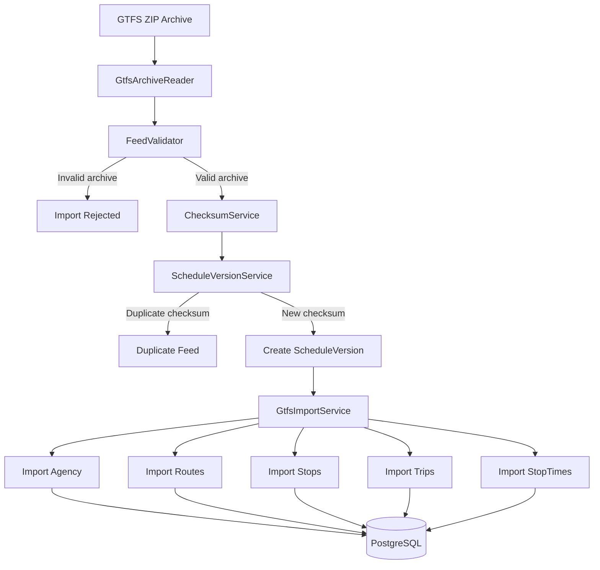

# Feed Processing Workflow

This diagram illustrates the process of importing, validating and storing GTFS feeds.



## Description

1. User uploads a GTFS archive.
2. The archive is read using `GtfsArchiveReader`.
3. `FeedValidator` verifies that all required GTFS files are present.
4. `ChecksumService` calculates a SHA-256 checksum.
5. `ScheduleVersionService` checks whether this feed has already been imported.
6. If the feed is new, a new schedule version is created.
7. `GtfsImportService` imports domain entities into PostgreSQL.
```
