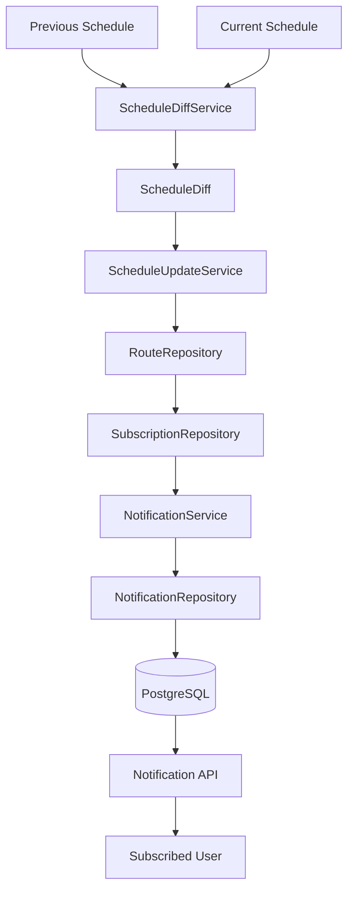

# Notification Workflow

This diagram describes how route changes generate user notifications.



## Description

1. Two schedule versions are compared.
2. `ScheduleDiffService` identifies route changes.
3. `ScheduleUpdateService` processes added and removed routes.
4. User subscriptions are retrieved.
5. `NotificationService` creates notifications for affected subscribers.
6. Notifications are saved in PostgreSQL.
7. Users retrieve notifications through the Notification API.
```
